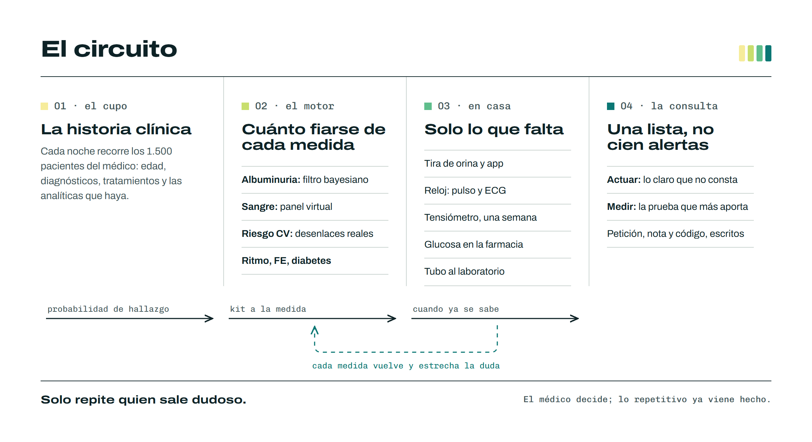
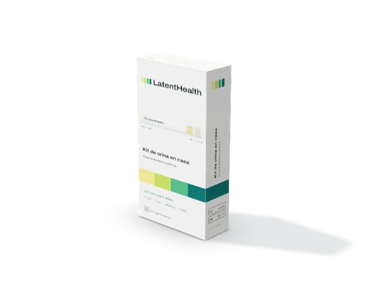
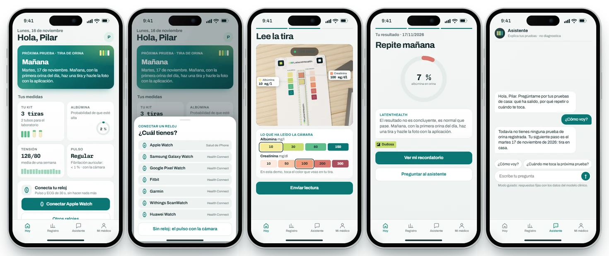

<div align="center">

<picture>
  <source media="(prefers-color-scheme: dark)" srcset="web/site/img/logos/01-carta-logotipo-negativo.svg">
  
</picture>

### El aviso del riñón y del corazón, medido en casa.

**Infraestructura de detección precoz cardio-renal-metabólica para atención primaria.**<br>
Recorre el cupo, decide qué falta medir a cada paciente, se lo mide en casa y le entrega al médico una lista ya ordenada.

Hackathon Boehringer · Reto 1, «Automatizar lo repetitivo»

</div>

---

## En una frase

LatentHealth no es un kit ni una app: es **el circuito que une la historia clínica, el paciente en su casa y el médico**, con modelos que saben cuánto fiarse de cada medida. El kit, la app, el reloj o la farmacia son solo los sensores; lo que cambia la consulta es que **nadie tenga que acordarse de pedir la prueba, repetirla ni escribir la nota**.

## El problema

La diabetes, la hipertensión, la enfermedad renal y la insuficiencia cardíaca se alimentan entre sí, y la primera señal, la albúmina en la orina, sale años antes que cualquier síntoma. Pero:

| | |
|---|---|
| **4 de cada 100** | hipertensos se hacen la prueba de orina en dos años. En diabéticos, 35 de cada 100 (Shin, *Hypertension* 2021, 3,7 millones de adultos). |
| **La mitad** | de los positivos de una muestra aislada no se repiten en la primera orina de la mañana (NHANES). Sin repetir, no hay diagnóstico. |
| **Más del 80 %** | de los pacientes con enfermedad renal en estadio 3 según su analítica no la tienen registrada (REVEAL-CKD). |
| **10 a 33 %** | de quienes deberían tomar un iSGLT2 lo toman. |

No faltan análisis: falta que la prueba **llegue a casa**, que **repetirla sirva de algo** y que el resultado **acabe en la historia**.

## La infraestructura

<p align="center"></p>

1. **El cupo.** Cada noche el sistema recorre la historia clínica de los 1.500 pacientes de un médico y calcula, para cada uno, la probabilidad de que las pruebas que le faltan den un hallazgo nuevo.
2. **El motor.** Un conjunto de modelos entrenados y validados con datos reales (NHANES, PhysioNet, Zenodo, cohortes españolas MUSIC y PREDIMED) que combinan todas las medidas con su incertidumbre y deciden **qué medir, a quién, por qué canal y cuándo parar**.
3. **En casa, sin cita.** Al paciente le llega solo lo que su ficha dice que falta: la tira de orina con la app, el reloj que ya tiene, un tensiómetro prestado una semana, una glucosa en la farmacia o un tubo al laboratorio. Sin móvil, la misma lógica funciona por carta, en la farmacia o en enfermería.
4. **En la consulta.** El médico abre una lista, no cien alertas: arriba lo que ya está claro y no consta; debajo, a quién le falta una prueba y cuál pedir primero. La petición, la nota y el código ya vienen escritos.

Cada medida que vuelve estrecha la duda y el motor decide si hace falta otra. **Solo repite quien sale dudoso.**

## En casa: el paciente

<table>
<tr>
<td width="50%" align="center"></td>
<td width="50%">

**El kit, a la medida de cada ficha.** Una cajita como la de un medicamento con tres tiras en sobres, un vaso plegable, la plantilla de color y dos tubos. La propia caja vuelve al laboratorio con el franqueo pagado. Si hace falta, se suma un tensiómetro prestado o el reloj del paciente.

Quitar el manguito no pierde nada medible (AUC 0,844 con y sin él), así que solo se presta a quien sale con la tensión alta. → [kit_en_casa.md](reports/kit_en_casa.md)

</td>
</tr>
</table>

<table>
<tr>
<td align="center" width="33%"></td>
<td align="center" width="33%"></td>
<td width="34%">

**Pregunta antes, como una persona.** Ejercicio intenso, fiebre, regla o escozor al orinar disparan la albúmina sin que haya daño; si hay alguno, la prueba se aplaza.

**Lee la tira con la cámara.** Las cuatro marcas de la plantilla dan la posición; los parches de color y de grises corrigen la luz de cada casa antes de leer la albúmina y la creatinina.

**Contesta qué hacer, no un número:** «ya está», «repite mañana» o «manda el tubo».

</td>
</tr>
</table>

<p align="center"></p>

La app conecta **Apple Watch y otros relojes** (Galaxy, Pixel, Fitbit, Garmin, Withings) para el pulso diario y un ECG de 30 segundos; sin reloj, el pulso se mide con la cámara. Un **asistente** explica cada resultado y no diagnostica, y el paciente puede escribir a su médico con sus pruebas adjuntas.

## En la consulta: el médico

<p align="center"></p>

- **Hoy:** el cupo ordenado por **lo que cambiaría**, no por quién está peor. *Actuar* recoge hallazgos claros sin diagnóstico registrado (albuminuria repetida, tensión alta en casa, pulso irregular dos días…). *Medir* ordena por probabilidad de hallazgo nuevo, con la prueba que más aporta y cómo hacerla desde casa.
- **La ficha:** por qué está en la lista, la rejilla KDIGO con la probabilidad de cada casilla, la tendencia del filtrado, las tiras, la tensión de la semana y el ECG del reloj.
- **Ya preparado:** la petición, la nota clínica con su código CIE-10-ES, las sugerencias de la guía *a valorar* y el mensaje al paciente. Un clic y queda en la historia.
- **Mensajes, kits e indicadores del cupo:** cobertura de la prueba de orina antes y ahora, y el embudo de kits enviados a diagnósticos nuevos.

## El motor

| Modelo | Qué hace | Con qué datos |
|---|---|---|
| **Filtro bayesiano de la albuminuria** | Estima el cociente albúmina/creatinina verdadero combinando tiras y laboratorio, con dilución, elevaciones pasajeras y censura | NHANES 2009-2010 |
| **Panel virtual de sangre** | FG, HbA1c, glucosa, potasio, colesterol no-HDL, hemoglobina y NT-proBNP con su incertidumbre, desde la historia y la orina | NHANES |
| **Riesgo cardiovascular con desenlaces** | Muerte cardiovascular sin analítica de sangre, frente a SCORE2 | NHANES enlazado con mortalidad; PREDIMED |
| **Fibrilación auricular** | Irregularidad del pulso entre latidos | 8.528 registros de PhysioNet 2017 |
| **Fracción de eyección baja** | 30 s de ECG de una derivación (y sonido del corazón) | 620 personas con ecocardiograma (Zenodo) |
| **Diabetes oculta** | Circuito de glucosa en la farmacia y HbA1c solo si sigue la duda | NHANES 2005-2018 |
| **Tendencia del FG** | Nivel y pendiente separando el descenso real del ruido | Simulación |
| **Lista del cupo y decisión** | Umbrales por utilidad clínica y la prueba que más información aporta | NHANES; recalibrado a España con ONDAAS |

## Resultados

| | |
|:---:|---|
| **75 de 100** | diabetes ocultas encontradas con una glucosa en la farmacia; el cuestionario FINDRISC encuentra 52 con los mismos análisis. → [diabetes_en_casa.md](reports/diabetes_en_casa.md) |
| **0,88** | AUC para detectar un corazón que bombea poco con 30 s de ECG de una derivación, frente al ecocardiograma (0,91 con el sonido). → [fraccion_eyeccion.md](reports/fraccion_eyeccion.md) |
| **0,97** | AUC del detector de fibrilación auricular por el ritmo del pulso. → [ritmo.md](reports/ritmo.md) |
| **+0,054** | AUC sobre SCORE2 al ordenar el riesgo de muerte cardiovascular en diabéticos e hipertensos, sin sacar sangre. → [riesgo_en_casa.md](reports/riesgo_en_casa.md) |
| **≈ 1.200** | muertes menos al año en España si se usara (rango 103 a 3.886). Es una **estimación con supuestos explícitos**, no un resultado medido. → [vidas_salvadas.md](reports/vidas_salvadas.md) |

**Lo que falta, dicho claro:** calibrar la lectura de la tira con muestras reales pareadas y validar en pacientes españoles con seguimiento. Los modelos se entrenaron con datos de EE. UU. y China. El detalle de qué está ajustado con datos y qué es un supuesto está en [docs/solucion.md](docs/solucion.md), apartado 5.

## Pruébalo

<p align="center"></p>

La web trae **«Pruébala»**, la app del paciente con pacientes de ejemplo en la que cada pantalla le pregunta al modelo de verdad, y **«El modelo, en vivo»** (arriba): añade tiras o muestras de laboratorio y mira cómo se estrecha la duda.

**La web** (un solo proceso sirve el sitio y las rutas `/api` que llaman a los modelos):

```powershell
powershell -ExecutionPolicy Bypass -File web\start.ps1
```

Abre <http://127.0.0.1:8000>. La documentación de la API está en `/api/docs`. Datos sintéticos; el asistente usa Claude si existe `ANTHROPIC_API_KEY` y, si no, contesta en modo guiado con los mismos datos del modelo.

**Los modelos desde la consola:**

```bash
uv sync
```

```bash
uv run python scripts/demo_casa.py
```

```bash
uv run pytest
```

`demo_casa.py` recorre el circuito entero (el paciente en casa y la lista del médico); `scripts/demo.py`, la ficha de cinco pacientes. Para rehacer modelos e informes desde los datos públicos, sigue el apartado 4 de [docs/solucion.md](docs/solucion.md).

<details>
<summary><b>Todos los informes</b></summary>

| Informe | Qué comprueba | Con qué |
|---|---|---|
| [validacion_albuminuria.md](reports/validacion_albuminuria.md) | El filtro de albuminuria | NHANES |
| [panel_sangre.md](reports/panel_sangre.md) | El panel virtual | NHANES |
| [robustez.md](reports/robustez.md) | FG y albuminuria juntos, calibración por grupos, umbrales | NHANES |
| [lista_cupo.md](reports/lista_cupo.md) | El orden de la lista del cupo | NHANES |
| [riesgo_en_casa.md](reports/riesgo_en_casa.md) | El riesgo con lo medido en casa frente a SCORE2 | NHANES y mortalidad |
| [kit_en_casa.md](reports/kit_en_casa.md) | Qué se pierde al quitar cada pieza del kit | NHANES y mortalidad |
| [insuficiencia_cardiaca.md](reports/insuficiencia_cardiaca.md) | Qué se sabe de la insuficiencia cardíaca desde casa | Personas con seguimiento |
| [fraccion_eyeccion.md](reports/fraccion_eyeccion.md) | Fracción de eyección baja con pulso, ECG y sonido | 620 personas con ecocardiograma |
| [pulso_insuficiencia_cardiaca.md](reports/pulso_insuficiencia_cardiaca.md) | Por qué el pulso solo no basta | PhysioNet y pacientes españoles |
| [insuficiencia_cardiaca_espana.md](reports/insuficiencia_cardiaca_espana.md) | Cuánto de la gravedad se ve desde casa | 992 pacientes españoles (MUSIC) |
| [diabetes_en_casa.md](reports/diabetes_en_casa.md) | Diabetes oculta: farmacia y glucómetro frente a FINDRISC | NHANES |
| [ritmo.md](reports/ritmo.md) | El detector de fibrilación auricular | 8.528 registros reales |
| [validacion_espana.md](reports/validacion_espana.md) | El riesgo cardiovascular en españoles | PREDIMED |
| [recalibracion_espana.md](reports/recalibracion_espana.md) | El ajuste a la primaria española | ONDAAS |
| [cribado_en_casa.md](reports/cribado_en_casa.md) | El protocolo en casa | Simulación |
| [tendencia_fg.md](reports/tendencia_fg.md) | La tendencia del filtrado | Simulación |
| [vidas_salvadas.md](reports/vidas_salvadas.md) | Muertes evitables al año | Supuestos explícitos |

</details>

<details>
<summary><b>Estructura del repositorio</b></summary>

| Ruta | Contenido |
|---|---|
| `web/site/` | La web: portada, kit 3D, app del paciente, panel del médico y modelo en vivo (HTML, CSS y JavaScript sin compilar) |
| `web/server/` | Servidor FastAPI que envuelve los modelos en rutas `/api` |
| `src/latenthealth/albuminuria/` | Filtro de la albuminuria, tira, preguntas de contexto y protocolo en casa |
| `src/latenthealth/panel/` | Panel virtual de sangre |
| `src/latenthealth/outcomes/` | Cohorte con mortalidad y modelo de riesgo |
| `src/latenthealth/assessment.py`, `worklist.py` | Evaluación de cada paciente y lista del cupo |
| `src/latenthealth/kit.py`, `home.py` | El kit de cada paciente y las medidas de casa |
| `src/latenthealth/rhythm.py`, `ejection.py`, `diabetes.py` | Fibrilación auricular, fracción de eyección y diabetes |
| `src/latenthealth/cvrisk.py`, `kidney_trend.py`, `decision.py`, `recalibration.py` | SCORE2, tendencia del FG, umbrales y ajuste a España |
| `scripts/` | Descarga de datos, ajuste, validación, simulación y demos |
| `models/`, `reports/`, `tests/` | Modelos entrenados, informes generados y tests |
| `docs/` | La solución completa, la marca, el guion del vídeo y las imágenes de este README |
| `video/` | Proyecto Remotion del vídeo |

</details>

<sub>Prototipo de apoyo a la decisión: no diagnostica ni pauta tratamientos. Pacientes y datos de la web, sintéticos.</sub>

---

<details>
<summary><b>Entrega del hackathon (instrucciones de la organización)</b></summary>

Welcome! This is your team's repository for developing and delivering your hackathon project.

### Where to work

Find your team's repository on the [organisation's repositories page](https://github.com/orgs/HackathonBoehringerIT/repositories).

Use only the private repository assigned to your team. Your teammates can access it after accepting their organisation invitations. Do not work in `base_template`; it is a shared, read-only starting point.

Your team can work in this repository throughout the hackathon. It is the one place to deliver your project—do not create or submit a separate repository.

### Submission deadline

The organisers will announce the final deadline and its time zone. **Any work uploaded after that deadline will not be taken into account.**

Before the deadline, make sure the final version is committed and pushed to the repository's `main` branch. If you use a pull request, merge it before the deadline; work left only on another branch or in an unmerged pull request may not be included in the final review.

You only need to deliver your project through this repository. You do **not** need to wait until the end to upload it: it is recommended that you make commits throughout the project, recording the different stages of your planning, development, and final result. This gives your team a useful history of how the project evolved.

### Before the deadline

- Confirm the final version is present on the `main` branch.
- Make sure any pull requests containing final work have been merged.
- Open the important files on GitHub and check that they render or download correctly.
- Confirm the work was committed and pushed before the announced deadline and time zone.

If you cannot access your team's repository, cannot push, or are unsure whether your work was submitted in time, contact an organiser as soon as possible.

</details>
