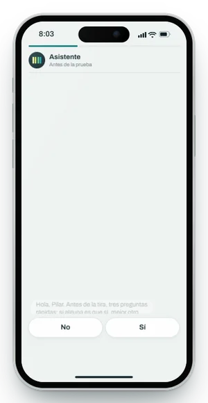
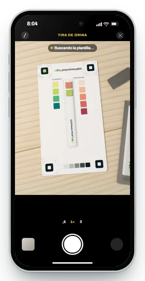
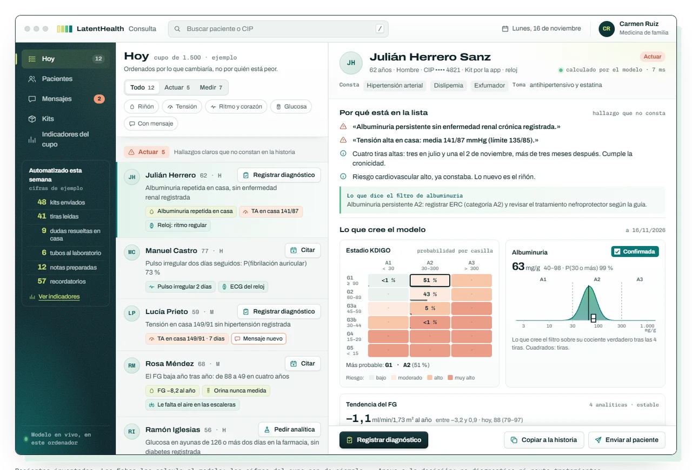
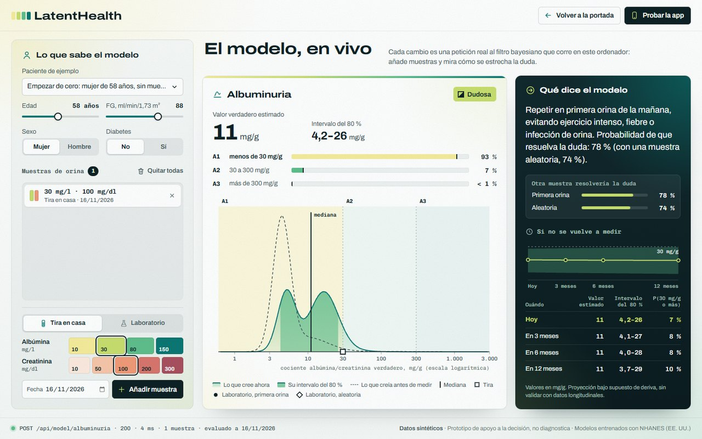

<div align="center">

<picture>
  <source media="(prefers-color-scheme: dark)" srcset="web/site/img/logos/01-carta-logotipo-negativo.svg">
  
</picture>

### The kidney and heart warning, measured at home.

**Early-detection infrastructure for cardio-renal-metabolic disease in primary care.**<br>
It scans the practice list, decides what each patient is missing, measures it at home and hands the doctor a ranked worklist.

Boehringer Hackathon · Challenge 1, "Automate the repetitive"

</div>

---

## In one sentence

LatentHealth is not a kit or an app: it is **the loop that connects the health record, the patient at home and the doctor**, with models that know how much to trust each measurement. The kit, the app, the watch and the pharmacy are just the sensors; what changes the visit is that **nobody has to remember to order the test, repeat it or write the note**.

## The problem

Diabetes, hypertension, kidney disease and heart failure feed each other, and the first sign, albumin in the urine, shows up years before any symptom. But:

| | |
|---|---|
| **4 in 100** | people with hypertension get the urine test within two years. In diabetes, 35 in 100 (Shin, *Hypertension* 2021, 3.7 million adults). |
| **Half** | of positives from a random sample do not repeat in the first morning urine (NHANES). Without a repeat, there is no diagnosis. |
| **Over 80%** | of patients with stage 3 kidney disease by their lab results do not have it recorded (REVEAL-CKD). |
| **10 to 33%** | of those who should be on an SGLT2 inhibitor are taking one. |

Lab tests are not what is missing: what is missing is for the test to **reach the home**, for **repeating it to mean something**, and for the result to **end up in the record**.

## The infrastructure

<p align="center"></p>

1. **The practice list.** Every night the system goes through the health records of a doctor's 1,500 patients and computes, for each one, the probability that the tests they are missing would produce a new finding.
2. **The engine.** A set of models trained and validated on real data (NHANES, PhysioNet, Zenodo, the Spanish cohorts MUSIC and PREDIMED) that combine every measurement with its uncertainty and decide **what to measure, in whom, through which channel and when to stop**.
3. **At home, no appointment.** The patient receives only what their record says is missing: the urine strip with the app, the watch they already own, a blood pressure monitor on loan for a week, a glucose test at the pharmacy or a lab tube. Without a smartphone, the same logic works by mail, at the pharmacy or with the nurse.
4. **In the clinic.** The doctor opens one worklist, not a hundred alerts: at the top, what is already clear but not recorded; below, who is missing a test and which one to order first. The order, the note and the code come pre-written.

Each measurement that comes back narrows the uncertainty, and the engine decides whether another one is needed. **Only borderline results get repeated.**

## At home: the patient

<table>
<tr>
<td width="50%" align="center"></td>
<td width="50%">

**The kit, tailored to each record.** A small box like a medicine pack with three strips in sachets, a collapsible cup, the color card and two tubes. The box itself goes back to the lab with prepaid postage. If needed, a loaned blood pressure monitor or the patient's own watch is added.

Leaving out the cuff loses nothing measurable (AUC 0.844 with and without it), so it is only loaned to people whose blood pressure comes out high. → [kit_en_casa.md](reports/kit_en_casa.md)

</td>
</tr>
</table>

<table>
<tr>
<td align="center" width="33%"></td>
<td align="center" width="33%"></td>
<td width="34%">

**Asks first, like a person would.** Intense exercise, fever, a period or burning when urinating push albumin up without any damage; if any applies, the test is postponed.

**Reads the strip with the camera.** The card's four markers give the position; the color and gray patches correct each home's lighting before reading albumin and creatinine.

**Answers what to do, not a number:** "you're done", "repeat tomorrow" or "send the tube".

</td>
</tr>
</table>

<p align="center"></p>

The app connects **Apple Watch and other watches** (Galaxy, Pixel, Fitbit, Garmin, Withings) for daily pulse and a 30-second ECG; without a watch, pulse is measured with the camera. An **assistant** explains each result without diagnosing, and the patient can message their doctor with their tests attached.

## In the clinic: the doctor

<p align="center"></p>

- **Today:** the practice list ranked by **what would change**, not by who is sickest. *Act* collects clear findings with no recorded diagnosis (repeated albuminuria, high blood pressure at home, irregular pulse on two days…). *Measure* ranks by probability of a new finding, with the most informative test and how to do it from home.
- **The record:** why the patient is on the list, the KDIGO grid with the probability of each cell, the eGFR trend, the strips, the week's blood pressure and the watch ECG.
- **Ready to go:** the order, the clinical note with its ICD-10 code, the guideline suggestions *to consider* and the message to the patient. One click and it is in the record.
- **Messages, kits and practice indicators:** urine test coverage before and now, and the funnel from kits sent to new diagnoses.

## The engine

| Model | What it does | Data |
|---|---|---|
| **Albuminuria Bayesian filter** | Estimates the true albumin-to-creatinine ratio by combining strips and lab results, accounting for dilution, transient elevations and censoring | NHANES 2009-2010 |
| **Virtual blood panel** | eGFR, HbA1c, glucose, potassium, non-HDL cholesterol, hemoglobin and NT-proBNP with their uncertainty, from the record and the urine | NHANES |
| **Cardiovascular risk with outcomes** | Cardiovascular death without a blood test, compared with SCORE2 | NHANES linked to mortality; PREDIMED |
| **Atrial fibrillation** | Beat-to-beat pulse irregularity | 8,528 recordings from PhysioNet 2017 |
| **Low ejection fraction** | 30 s of single-lead ECG (and heart sound) | 620 people with echocardiogram (Zenodo) |
| **Undiagnosed diabetes** | Pharmacy glucose pathway, with HbA1c only if doubt remains | NHANES 2005-2018 |
| **eGFR trend** | Level and slope, separating true decline from noise | Simulation |
| **Practice worklist and decisions** | Thresholds based on clinical utility and the most informative test | NHANES; recalibrated to Spain with ONDAAS |

## Results

| | |
|:---:|---|
| **75 in 100** | cases of undiagnosed diabetes found with one pharmacy glucose test; the FINDRISC questionnaire finds 52 with the same number of lab tests. → [diabetes_en_casa.md](reports/diabetes_en_casa.md) |
| **0.88** | AUC for detecting a weakly pumping heart from 30 s of single-lead ECG, against echocardiography (0.91 with heart sound). → [fraccion_eyeccion.md](reports/fraccion_eyeccion.md) |
| **0.97** | AUC of the atrial fibrillation detector based on pulse rhythm. → [ritmo.md](reports/ritmo.md) |
| **+0.054** | AUC over SCORE2 when ranking cardiovascular death risk in people with diabetes or hypertension, without drawing blood. → [riesgo_en_casa.md](reports/riesgo_en_casa.md) |
| **≈ 1,200** | fewer deaths per year in Spain if it were used (range 103 to 3,886). This is an **estimate with explicit assumptions**, not a measured result. → [vidas_salvadas.md](reports/vidas_salvadas.md) |

**What is still missing, plainly:** calibrating the strip reading with real paired samples and validating in Spanish patients with follow-up. The models were trained on data from the US and China. What is fitted to data and what is an assumption is detailed in [docs/solution.md](docs/solution.md), section 5.

## Try it

<p align="center"></p>

The website includes **"Try it"**, the patient app with sample patients where every screen queries the real model, and **"The model, live"** (above): add strips or lab samples and watch the uncertainty narrow.

**The website** (a single process serves the site and the `/api` routes that call the models):

```powershell
powershell -ExecutionPolicy Bypass -File web\start.ps1
```

Open <http://127.0.0.1:8000>. The API documentation is at `/api/docs`. Synthetic data; the assistant uses Claude if `ANTHROPIC_API_KEY` is set and otherwise answers in guided mode with the same model data.

**The models from the command line:**

```bash
uv sync
```

```bash
uv run python scripts/demo_casa.py
```

```bash
uv run pytest
```

`demo_casa.py` runs the whole loop (the patient at home and the doctor's worklist); `scripts/demo.py`, the records of five patients. To rebuild models and reports from the public data, follow section 4 of [docs/solution.md](docs/solution.md).

<details>
<summary><b>All reports</b></summary>

| Report | What it checks | Data |
|---|---|---|
| [validacion_albuminuria.md](reports/validacion_albuminuria.md) | The albuminuria filter | NHANES |
| [panel_sangre.md](reports/panel_sangre.md) | The virtual panel | NHANES |
| [robustez.md](reports/robustez.md) | eGFR and albuminuria together, calibration by subgroup, thresholds | NHANES |
| [lista_cupo.md](reports/lista_cupo.md) | The ranking of the practice worklist | NHANES |
| [riesgo_en_casa.md](reports/riesgo_en_casa.md) | Risk from home measurements compared with SCORE2 | NHANES and mortality |
| [kit_en_casa.md](reports/kit_en_casa.md) | What is lost by removing each piece of the kit | NHANES and mortality |
| [insuficiencia_cardiaca.md](reports/insuficiencia_cardiaca.md) | What can be known about heart failure from home | People with follow-up |
| [fraccion_eyeccion.md](reports/fraccion_eyeccion.md) | Low ejection fraction from pulse, ECG and heart sound | 620 people with echocardiogram |
| [pulso_insuficiencia_cardiaca.md](reports/pulso_insuficiencia_cardiaca.md) | Why pulse alone is not enough | PhysioNet and Spanish patients |
| [insuficiencia_cardiaca_espana.md](reports/insuficiencia_cardiaca_espana.md) | How much of the severity can be seen from home | 992 Spanish patients (MUSIC) |
| [diabetes_en_casa.md](reports/diabetes_en_casa.md) | Undiagnosed diabetes: pharmacy and glucometer vs. FINDRISC | NHANES |
| [ritmo.md](reports/ritmo.md) | The atrial fibrillation detector | 8,528 real recordings |
| [validacion_espana.md](reports/validacion_espana.md) | Cardiovascular risk in Spanish people | PREDIMED |
| [recalibracion_espana.md](reports/recalibracion_espana.md) | Adjustment to Spanish primary care | ONDAAS |
| [cribado_en_casa.md](reports/cribado_en_casa.md) | The home protocol | Simulation |
| [tendencia_fg.md](reports/tendencia_fg.md) | The eGFR trend | Simulation |
| [vidas_salvadas.md](reports/vidas_salvadas.md) | Preventable deaths per year | Explicit assumptions |

</details>

<details>
<summary><b>Repository structure</b></summary>

| Path | Contents |
|---|---|
| `web/site/` | The website: home page, 3D kit, patient app, doctor's dashboard and live model (uncompiled HTML, CSS and JavaScript) |
| `web/server/` | FastAPI server that wraps the models in `/api` routes |
| `src/latenthealth/albuminuria/` | Albuminuria filter, strip, context questions and home protocol |
| `src/latenthealth/panel/` | Virtual blood panel |
| `src/latenthealth/outcomes/` | Mortality cohort and risk model |
| `src/latenthealth/assessment.py`, `worklist.py` | Per-patient assessment and practice worklist |
| `src/latenthealth/kit.py`, `home.py` | Each patient's kit and home measurements |
| `src/latenthealth/rhythm.py`, `ejection.py`, `diabetes.py` | Atrial fibrillation, ejection fraction and diabetes |
| `src/latenthealth/cvrisk.py`, `kidney_trend.py`, `decision.py`, `recalibration.py` | SCORE2, eGFR trend, thresholds and adjustment to Spain |
| `scripts/` | Data download, fitting, validation, simulation and demos |
| `models/`, `reports/`, `tests/` | Trained models, generated reports and tests |
| `docs/` | The full solution, the brand, the video script and the images in this README |
| `video/` | Remotion project for the video |

</details>

<sub>Decision-support prototype: it does not diagnose or prescribe treatment. Patients and data on the website are synthetic.</sub>

---

<details>
<summary><b>Hackathon submission (organisers' instructions)</b></summary>

Welcome! This is your team's repository for developing and delivering your hackathon project.

### Where to work

Find your team's repository on the [organisation's repositories page](https://github.com/orgs/HackathonBoehringerIT/repositories).

Use only the private repository assigned to your team. Your teammates can access it after accepting their organisation invitations. Do not work in `base_template`; it is a shared, read-only starting point.

Your team can work in this repository throughout the hackathon. It is the one place to deliver your project—do not create or submit a separate repository.

### Submission deadline

The organisers will announce the final deadline and its time zone. **Any work uploaded after that deadline will not be taken into account.**

Before the deadline, make sure the final version is committed and pushed to the repository's `main` branch. If you use a pull request, merge it before the deadline; work left only on another branch or in an unmerged pull request may not be included in the final review.

You only need to deliver your project through this repository. You do **not** need to wait until the end to upload it: it is recommended that you make commits throughout the project, recording the different stages of your planning, development, and final result. This gives your team a useful history of how the project evolved.

### Before the deadline

- Confirm the final version is present on the `main` branch.
- Make sure any pull requests containing final work have been merged.
- Open the important files on GitHub and check that they render or download correctly.
- Confirm the work was committed and pushed before the announced deadline and time zone.

If you cannot access your team's repository, cannot push, or are unsure whether your work was submitted in time, contact an organiser as soon as possible.

</details>
